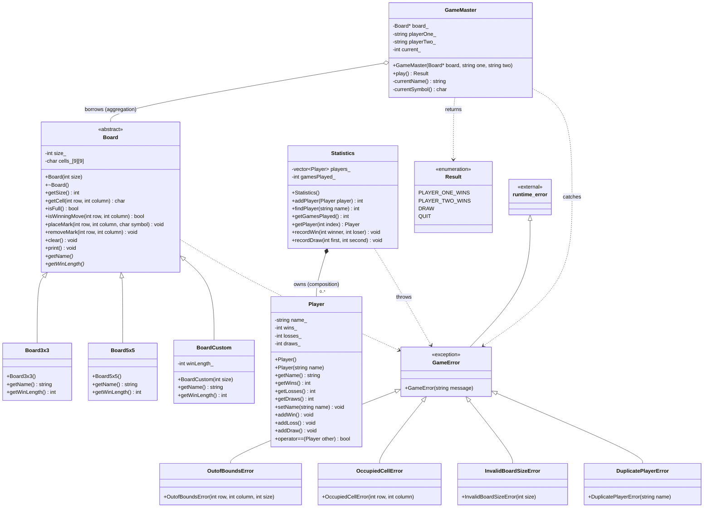

# TIC TAC TOE

A two-player tic-tac-toe game for the terminal, written in C++17. Players enter
their names, choose a board, and play as many matches as they'd like while the
program keeps a scoreboard for the whole session.

## Features

- Three board types, one allowing some customization:
  - **3x3** with three in a row wins.
  - **5x5** with four in a row wins.
  - **Custom 3–9** with three in a row on a 3x3, four in a row from 4x4 upwards.
- Win detection.
- A scoreboard with wins, losses and draws.
- Sides swap after every match, so no one hogs the first move advantage.
- Board input error handling.

## Requirements

- A C++17 compiler.

## Build and run

### With make

From the game root:

```bash
make        # builds ./tictactoe
make run    # builds and starts the game
make clean  # removes build/ and the binary
```

### Without make

```bash
g++ -std=c++17 -Wall -Wextra -Iinclude src/*.cpp -o tictactoe
./tictactoe
```

## How to play

1. Enter two player names. Blank names are rejected.
2. Choose a board: `1` for 3x3, `2` for 5x5, `3` for a custom size.
3. On your turn, type a row and a column separated by a space, for example
   `2 3`. Coordinates are **1-based**: `1 1` is the top-left cell.
4. After a win or a draw the scoreboard is printed. Answer `y` to play another
   match on the same board, or `n` to stop.
5. End of input (Ctrl-D) exits at any prompt.

## Example session

```text
===========================================
                TIC TAC TOE
===========================================

PLAYER 1: Alice
PLAYER 2: Bob

CHOOSE YOUR BOARD:
  1) 3x3 - three in a row
  2) 5x5 - four in a row
  3) custom size (3-9)
CHOICE: 1

===========================================
 Alice MOVES (X)
 BOARD: 3x3 - 3 IN A ROW

    1 2 3
1   # # #
2   # # #
3   # # #

ROW AND COLUMN: 1 1

===========================================
 Bob MOVES (O)
 BOARD: 3x3 - 3 IN A ROW

    1 2 3
1   X # #
2   # # #
3   # # #

ROW AND COLUMN: 1 1
CELL TAKEN: (1, 1) already has been marked.

[...]

===========================================
 Alice MOVES (X)
 BOARD: 3x3 - 3 IN A ROW

    1 2 3
1   X X #
2   # O O
3   # # #

ROW AND COLUMN: 1 3

    1 2 3
1   X X X
2   # O O
3   # # #

===========================================
 :D :D :D :D :D :D :D :D :D :D :D :D :D :D
        CONGRATS Alice! EPIC WIN
 :D :D :D :D :D :D :D :D :D :D :D :D :D :D
===========================================

===========================================
 :( :( :( :( :( :( :( :( :( :( :( :( :( :(
        WOMP WOMP Bob... BIG LOSS
 :( :( :( :( :( :( :( :( :( :( :( :( :( :(
===========================================

============ CURRENT STATISTICS ============
 || NAME       || WINS   || LOSSES   || DRAWS   ||
 || Alice      || 1      || 0        || 0       ||
 || Bob        || 0      || 1        || 0       ||
============================================
 GAMES PLAYED: 1
============================================

KEEP PLAYING? [Y/N] n
```

## UML class diagram


